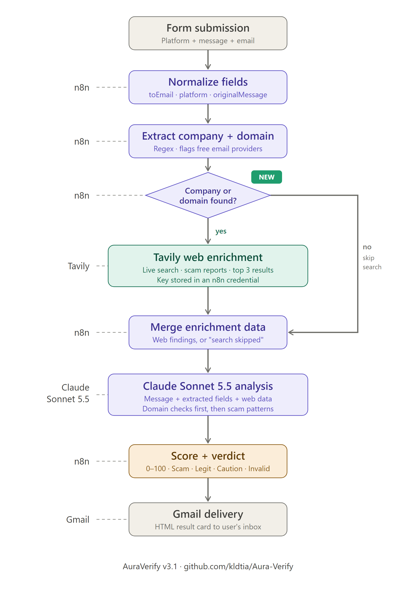

# 🦅 AuraVerify — AI Recruiter Scam Detector

> **Free. No signup. Instant results.**  
> Paste any suspicious recruiter message and AuraVerify will analyze it, look up the company in real time, and deliver a scored verdict straight to your inbox.

---

## 🔍 What It Does

Job seeker scams are everywhere — fake recruiters, spoofed domains, phishing disguised as outreach. AuraVerify was built to protect job seekers who don't have a cybersecurity background to fall back on.

Submit a suspicious message → AuraVerify analyzes the text, looks up the company live, and returns a **scam score (0–100)**, a **verdict** (Scam · Legit · Proceed with Caution · Invalid), and specific, evidence-backed reasons.

---

## ⚙️ How It Works

```
[Form Submission]  Platform · Message · Email
       ↓
[Normalize Fields]
       ↓
[Extract Company + Domain]
       ↓
[Has Company or Domain?] ──no──┐
       ↓ yes                   │
[Tavily Web Search]            │
       ↓                       │
[Merge Enrichment Data] ◄──────┘
       ↓
[Claude Sonnet 5.5 — AI Scam Analysis]
       ↓
[Parse & Format — HTML Result Card]
       ↓
[Gmail — Email Delivery]
```

See [`docs/architecture-diagram.md`](./docs/architecture-diagram.md) for what each step does and the data passed between them.



---

## 🛠️ Tech Stack

| Tool | Role |
|------|------|
| **n8n** | Workflow automation (no-code) |
| **Claude Sonnet 5.5** (Anthropic) | AI scam analysis and reasoning |
| **Tavily** | Real-time web enrichment & company lookup |
| **Gmail** | Automated result delivery |

---

## 🚀 Try It Live

👉 [Test AuraVerify Now](https://kdean.app.n8n.cloud/form/b50b00ec-4b57-489a-832d-dec80ef92f05)

No account required. Just paste your message, select the platform, and get results.

---

## 📁 Repo Structure

```
Aura-Verify/
├── README.md
├── LICENSE
├── workflow/
│   └── auraverify_v3.json                 # n8n workflow export (import-ready)
├── samples/
│   └── test_inputs.md                     # Sample messages + expected verdicts
└── docs/
    ├── architecture-diagram.md            # Step-by-step pipeline & data flow
    ├── auraverify_v3.1_architecture_diagram.png   # + .svg source
    ├── auraverify_v3_architecture_diagram.png     # previous version
    └── AVlogo.png
```

---

## 📥 How to Import the Workflow

1. Open your **n8n** instance
2. Go to **Workflows → Import from File**
3. Upload `workflow/auraverify_v3.json`
4. Add your credentials:
   - **Anthropic API key** → attach to the *Anthropic Chat Model* node
   - **Tavily API key** → create a **Header Auth** credential with Name `Authorization` and Value `Bearer tvly-<your key>`, then attach it to the *Tavily Web Search* node
   - **Gmail OAuth** → attach to the *Email Result* node
5. In the *Normalize Fields* node, replace the fallback `you@example.com` with your own address (used only if the form's Email field is blank)
6. Check **⋯ → Settings**: successful and manual executions are set to *Do not save* so submitted messages aren't kept. Set *Save failed production executions* to *Do not save* as well if you want nothing stored.
7. Activate the workflow — your form URL will appear in the trigger node

> ⚠️ Note: Credential test may show an error in n8n 2.13.x — this is a known bug. Save and run anyway; it works.

---

## 📊 Version History

| Version | Date | What Changed |
|---------|------|--------------|
| v1.0 | Aug 2025 | Initial launch with GPT-4o-mini |
| v2.0 | Apr 2026 | Migrated to Claude Sonnet 4.5 — improved reasoning depth |
| v3.0 | May 2026 | Added real-time Tavily web enrichment for company verification |
| v3.1 | Nov 2026 | Runs on Claude Sonnet 5.5 · Tavily key moved into an n8n credential · web search skipped when no company/domain is found · Web Enrichment section now shows in result emails · fixed doubled email subject · Discord/Other platforms recognized · successful executions no longer stored |

---

## 👩🏾‍💻 Built By

**Katia Dean** —  AI Builder  
[LinkedIn](https://www.linkedin.com/in/katiadean/) · [Notion Project Page](https://towering-twig-329.notion.site/Aura-Verify-33be50fba7ff80ddbbd1e4184b70d764) · [GitHub](https://github.com/kldtia)

*Built under Katia's Cylife AI*

---

## 📄 License

MIT License — free to use, adapt, and build on. See [`LICENSE`](./LICENSE).
